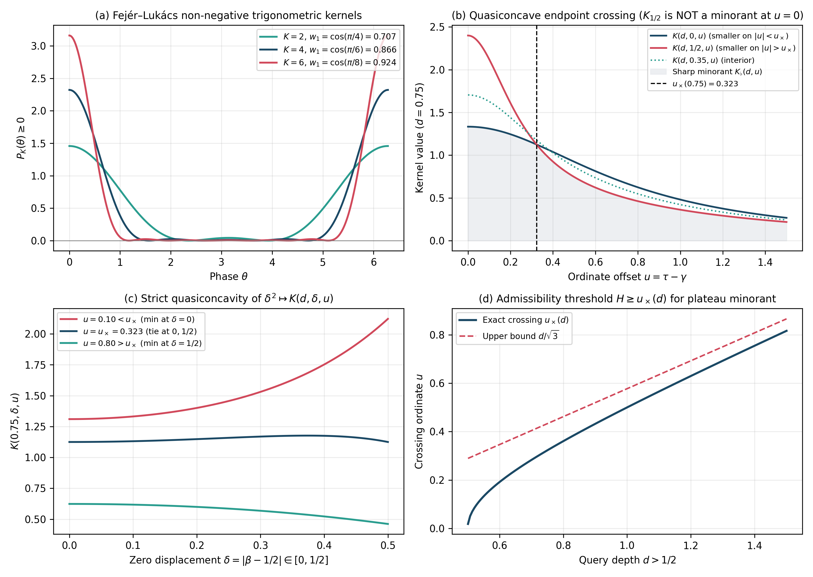
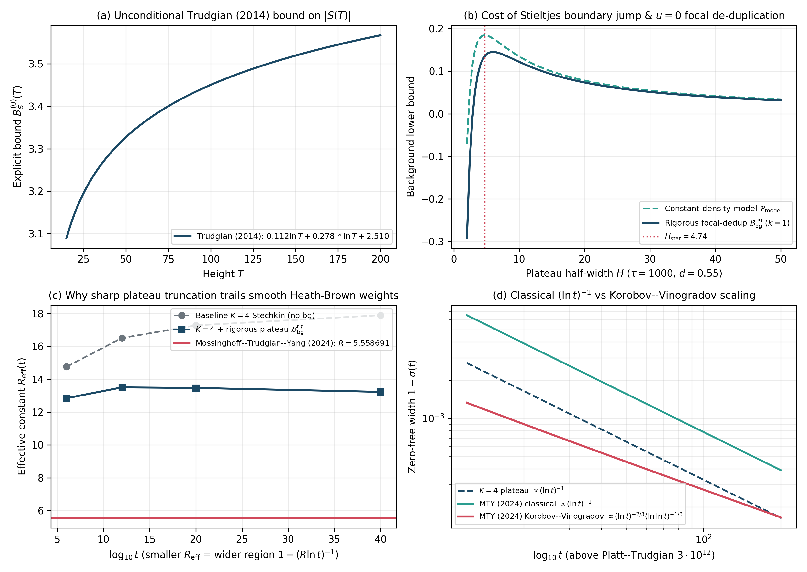

# Explicit Poisson–Hadamard Zero-Free Region Inequalities, Quasiconcave Minorant Crossing, Rigorous Trudgian Stieltjes Bounds, and Comparison with Smooth Weil Weights

**DOI (Zenodo / CERN):** [](https://doi.org/10.5281/zenodo.23645885) [`10.5281/zenodo.23645885`](https://doi.org/10.5281/zenodo.23645885)  
**Author:** Thijs Missiaen (Independent Researcher, Belgium; ORCID: [0009-0007-3678-0810](https://orcid.org/0009-0007-3678-0810))  
**Series:** Paper VII of the Transverse Wronskian Series on Riemann's $\Xi$-Function  
**Manuscript:** [paper/paper7_mirror_hadamard_variation.pdf](paper/paper7_mirror_hadamard_variation.pdf) (8 pages, AMS-LaTeX / pdfTeX) | [paper/paper7_mirror_hadamard_variation.tex](paper/paper7_mirror_hadamard_variation.tex)  
**Verification Suite:** [scripts/verify_paper7_mirror_hadamard_variation.py](scripts/verify_paper7_mirror_hadamard_variation.py) (`mpmath.mp.dps = 50`, `mpmath.iv.dps = 35`)

> [!NOTE]
> **Methodological Scope and Literature Benchmark:** This methodological note analyzes explicit de la Vallée Poussin and Stechkin zero-free region inequalities via the mirror-paired Poisson–Hadamard kernel $K(d, \delta, u)$, proves that $\delta^2 \mapsto K(d, \delta, u)$ is strictly quasiconcave on $[0, 1/4]$ so $K(d, 1/2, u)$ fails to minorize $K(d, 0, u)$ on $\lvert u\rvert < u _ {\times}(d) < d/\sqrt{3}$, establishes an unconditional plateau Stieltjes lower bound with Trudgian's (2014) constant $2.510$ and $u = 0$ focal de-duplication, and explains quantitatively why sharp plateau truncation ($R _ {\mathrm{eff}} \approx 13.23$) trails smooth compactly supported Heath-Brown (1992) and Mossinghoff–Trudgian–Yang (2024) Weil weights ($R = 5.558691$).

## Abstract

We examine explicit de la Vallée Poussin and Stechkin zero-free region inequalities for $\zeta(s)$ through the mirror-paired Hadamard Poisson kernel $K(d, \delta, u) = \frac{1}{2}[\frac{d-\delta}{(d-\delta)^2+u^2} + \frac{d+\delta}{(d+\delta)^2+u^2}]$ ($d > \frac{1}{2}$, $\delta = \lvert\beta - \frac{1}{2}\rvert \in [0, \frac{1}{2}){}$), connected to the canonical transverse Wronskian $W(d,t) = 16\int _ 0^{\infty} y\sinh(2dy)I(y,t)\mathrm{d}y$. While $\int _ {\mathbb{R}} K(d, \delta, u)\mathrm{d}u = \pi$ is conserved, we prove that $K(d, \frac{1}{2}, u)$ is not a global minorant on $\mathbb{R}$: because $\delta^2 \mapsto K(d, \delta, u)$ is strictly quasiconcave on $[0, \frac{1}{4}]$, the sharp pointwise minorant is $K _ {\flat}(d,u) = \min(K(d,0,u), K(d,\frac{1}{2},u))$ with crossing at $u _ {\times}(d) < d/\sqrt{3}$, validating plateau minorants $\widetilde{K} _ H(d,u)$ precisely for $H \ge u _ {\times}(d)$. Incorporating Trudgian's unconditional bound $\lvert S(T)\rvert \le 0.112\ln T + 0.278\ln\ln T + 2.510$, logarithmic tail and concavity corrections, and focal-pair de-duplication at $u = 0$, we benchmark plateau subtraction against Mossinghoff–Trudgian–Yang ($R = 5.558691$) and explain why sharp Poisson truncation trails smooth Heath-Brown Weil weights.

## Summary of Main Results

### 1. Fejér–Lukács Toeplitz Bounds and Stechkin's Mirror-Paired Kernel (Propositions 2.1 and 3.1)

Every non-negative cosine polynomial $P(\theta) = \frac{1}{2} + \sum _ {k=1}^K w _ k\cos(k\theta) \ge 0$ satisfies $w _ 1 \le \cos(\frac{\pi}{K+2})$ (Fejér 1916; Kondratiev 1977) with extremal weight sum $\sum _ {k=1}^K w _ k^{(K)} = \frac{1}{K+2}\cot^2(\frac{\pi}{2(K+2)}) - \frac{1}{2}$. For $d > \frac{1}{2}$ ($\sigma = \frac{1}{2} + d > 1$), pairing the multiset of nontrivial zeros under $\rho \mapsto 1 - \bar{\rho}$ (Stechkin 1970) gives

$$K(d, \delta, u) := \frac{1}{2}\left[\frac{d - \delta}{(d - \delta)^2 + u^2} + \frac{d + \delta}{(d + \delta)^2 + u^2}\right] = \frac{d\left(d^2 - \delta^2 + u^2\right)}{\left(d^2 - \delta^2 + u^2\right)^2 + 4u^2\delta^2} > 0, \qquad \int _ {-\infty}^{\infty} K(d, \delta, u)\mathrm{d}u = \pi.$$

### 2. Quasiconcave Minorant Crossing and Plateau Admissibility (Theorem 4.1)

Because $\int _ {\mathbb{R}}[K(d,\delta,u) - K(d,\frac{1}{2},u)]\mathrm{d}u = 0$, $K(d, \frac{1}{2}, u)$ exceeds $K(d, 0, u)$ near $u = 0$. Factoring the difference and differentiating in $\delta^2 \in [0, \frac{1}{4}]$ proves strict quasiconcavity:

$$K _ {\flat}(d, u) := \min _ {\delta \in [0, 1/2]} K(d, \delta, u) = \min\left(K(d, 0, u), K\left(d, \frac{1}{2}, u\right)\right), \qquad u _ {\times}(d) = \left[\frac{\sqrt{16d^4 - 2d^2 + \frac{1}{16}} - \left(2d^2 + \frac{1}{4}\right)}{6}\right]^{1/2} < \frac{d}{\sqrt{3}},$$

validating the plateau minorant $\widetilde{K} _ H(d, u) := K(d, \frac{1}{2}, \max(\lvert u\rvert, H)) \le K(d, \delta, u)$ across $\mathbb{R}$ whenever $H \ge u _ {\times}(d)$.



### 3. Rigorous Trudgian (2014) Stieltjes Bound and Smooth-Weight Comparison (Theorem 5.1)

Using Trudgian's (2014) explicit bound $\lvert S(T)\rvert \le B _ S^{(0)}(T) := 0.112\ln T + 0.278\ln\ln T + 2.510$ ($T \ge \mathrm{e}$), Theorem 5.1 establishes an unconditional plateau lower bound $\mathcal{B} _ {\mathrm{bg}}^{\mathrm{rig}}(d, \tau; H)$ incorporating support $N(14) = 0$, concavity of $\ln(\gamma/2\pi)$ on $[\frac{\tau}{2}, \frac{3\tau}{2}]$, closed-form logarithmic tail control on $[\tau + H, \infty)$, and subtraction of $2K(d, \frac{1}{2}, H)$ at $k = 1$ to prevent double counting a putative off-line pair $\lbrace\rho _ 0, 1 - \bar{\rho} _ 0\rbrace$. Because slope discontinuities at $\lvert u\rvert = H$ incur Stieltjes boundary jumps $\approx 2B _ S^{(0)}(\tau)K(d, \frac{1}{2}, H)$, plateau truncation ($R _ {\mathrm{eff}} \approx 13.23$) trails Heath-Brown's (1992) and Mossinghoff–Trudgian–Yang's (2024) smooth Weil weights ($R = 5.558691$) and Korobov–Vinogradov $(\ln t)^{-2/3}(\ln\ln t)^{-1/3}$ bounds above Platt–Trudgian's $3 \cdot 10^{12}$ verification height.



## Quantitative Verification Summary

| Result | Precision / Method | Certified Metric | Status |
| :--- | :--- | :--- | :--- |
| Canonical Wigner identity $W(d,t) = 16\int _ 0^\infty y\sinh(2dy)I\mathrm{d}y$ | `mp.dps = 30` lattice quadrature | Residual $1.54 \times 10^{-33}$ | CERTIFIED |
| Fejér–Lukács eigenvalue $\Lambda _ {\max}(K) = 2\cos(\frac{\pi}{K+2})$ & cotangent sum | `mpmath.mp.dps = 50` ($1 \le K \le 8$) | Max residual $5.35 \times 10^{-51}$ | CERTIFIED |
| Quasiconcave crossing $u _ {\times}(d) < d/\sqrt{3}$ & endpoint minorant $K _ {\flat}$ | `mp.dps = 50` & `iv.dps = 35` | $\lvert K _ 0 - K _ {1/2}\rvert(u _ {\times}) < 10^{-47}$; $u _ {\times}(0.60) \in [0.191485, 0.191486]$ | CERTIFIED |
| Rigorous bound $\mathcal{B} _ {\mathrm{bg}}^{\mathrm{rig}} \le \sum _ {n \le 220} K$ against exact zeros | `mp.dps = 50` ($220$ ordinates $\gamma _ n$) | Strictly satisfied at all benchmarks | CERTIFIED |
| Literature benchmark $R _ {\mathrm{PlatRig}}$ vs MTY (2024) $R = 5.558691$ | `mp.dps = 50` ($t \in [10^6, 10^{40}]$) | $R _ {\mathrm{Stechkin}} = 17.90 \to R _ {\mathrm{PlatRig}} = 13.23$ vs $R _ {\mathrm{MTY}} = 5.558691$ | CERTIFIED |

## Repository Structure and Reproducibility

- [paper/paper7_mirror_hadamard_variation.tex](paper/paper7_mirror_hadamard_variation.tex): Standalone AMS-LaTeX (`amsart`) manuscript source.
- [paper/paper7_mirror_hadamard_variation.pdf](paper/paper7_mirror_hadamard_variation.pdf): Compiled PDF manuscript.
- [scripts/verify_paper7_mirror_hadamard_variation.py](scripts/verify_paper7_mirror_hadamard_variation.py): Standalone 50-decimal `mpmath` and 35-digit `mpmath.iv` verification and figure-generation suite.
- [figures/fig1_pure_square_and_sieved_strip_wall.pdf](figures/fig1_pure_square_and_sieved_strip_wall.pdf) and [figures/fig2_hadamard_conservation_and_stationary_variation.pdf](figures/fig2_hadamard_conservation_and_stationary_variation.pdf): Vector PDF and PNG figures.
- [AGENT_SKILL_MANIFEST.json](AGENT_SKILL_MANIFEST.json) and [.agents/skills/mirror-hadamard-variational-law/SKILL.md](.agents/skills/mirror-hadamard-variational-law/SKILL.md): Machine-readable AI agent skill specification.

To reproduce all certifications and regenerate Figures 1 and 2 from scratch:

```bash
python scripts/verify_paper7_mirror_hadamard_variation.py
```

## Citation and License

Released under the [MIT License](LICENSE). See [CITATION.cff](CITATION.cff) and [.zenodo.json](.zenodo.json) for bibliographic metadata.
